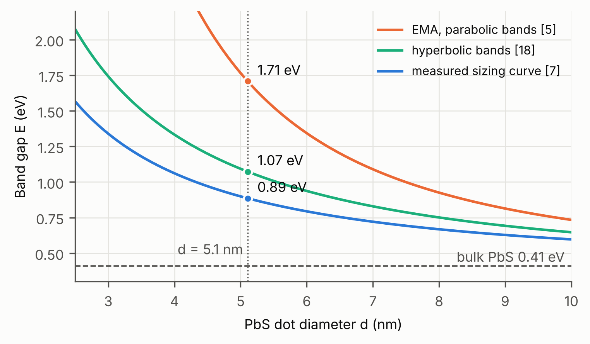
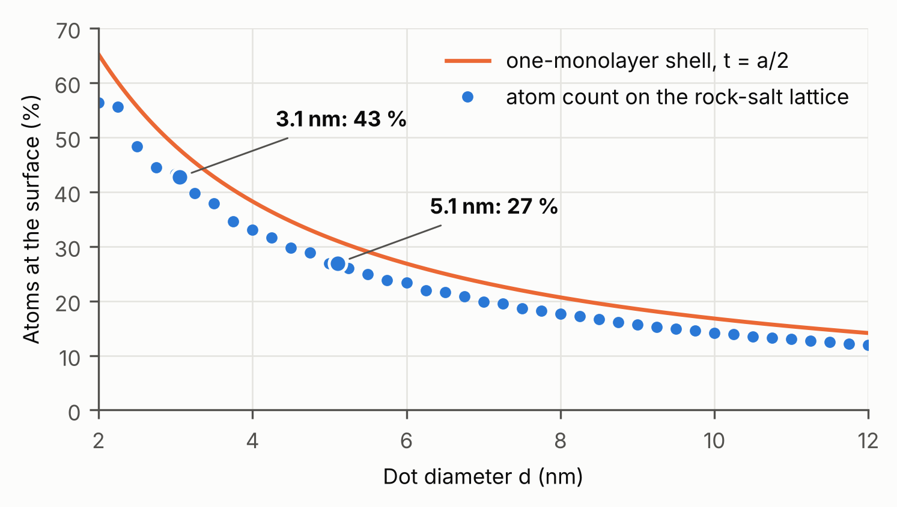
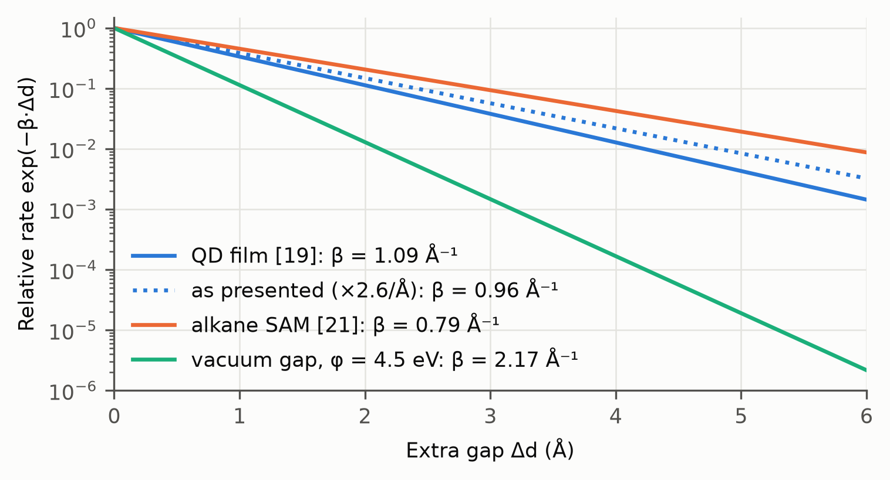
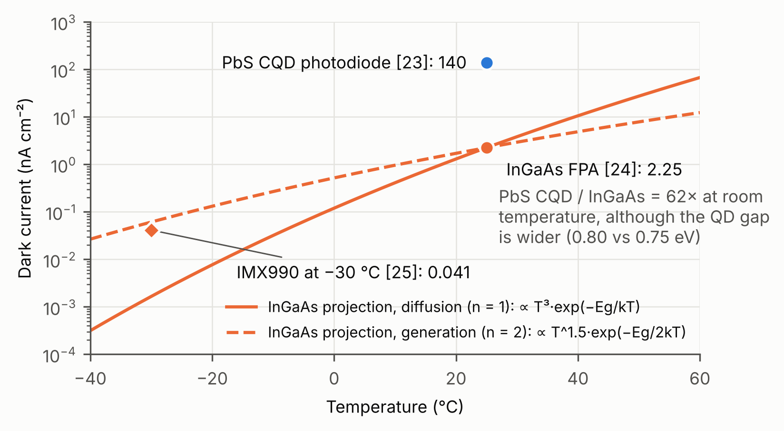

# Quantum-Dot-Photodetector

[](https://github.com/Shuruyue/Quantum-Dot-Photodetector/actions/workflows/ci.yml)


## PbS Colloidal Quantum-Dot Photodetector Models

The calculations behind the quantum-dot part of the report *Nanoscale Detectors: Quantum Dots & MOFs* (Nanotechnology, Group 10). A PbS colloidal quantum-dot (CQD) film coated on a silicon readout chip absorbs visible and short-wave infrared (SWIR) light; the dot size sets the absorption edge. The models here answer four questions: how dot size sets the band gap, how many atoms sit at the dot surface, how fast carriers tunnel between dots, and why CQD photodiodes have more dark current than InGaAs.

Every calculated number on the slides and in the spoken script is produced by this package and listed in `quantum_dot_photodetector/slides.py` with the slide it appears on; the validation suite checks each one against the model. Literature values (measured dark currents, D*, pixel pitches) are inputs and are listed with their sources under Parameters.

Energies are in eV, dot diameters in nm, tunnelling lengths in Å, dark-current densities in A cm⁻².

## Project Overview

### Core Features

- **Quantum size effect** — band gap vs dot diameter from the parabolic-band effective-mass approximation (Brus), the two-band hyperbolic model (Wang et al.) and the measured sizing curve of Moreels et al.; inversion from detection wavelength to dot diameter.
- **Surface atoms** — fraction of atoms with an incomplete first coordination shell, counted on the rock-salt lattice inside a sphere, compared with a continuum one-monolayer shell.
- **Tunnelling between dots** — decay constant β from the measured ligand-length dependence of mobility, compared with alkanethiol monolayers and a vacuum gap.
- **Dark current** — ideal-diode diffusion (n = 1) and generation (n = 2) limits: effect of a smaller gap, halving interval on cooling, temperature projection of a measured InGaAs value.
- **Detector metrics** — responsivity, shot-noise-limited specific detectivity D*, pixel-area ratios.
- **Validation** — 102 automated checks plus unit tests, run in CI on every push.

## Quick Start

### Installation

```bash
git clone https://github.com/Shuruyue/Quantum-Dot-Photodetector.git
cd Quantum-Dot-Photodetector
pip install -e ".[dev]"
```

### Usage

```bash
python scripts/summary.py         # every number in the report → outputs/results.json
python scripts/make_figures.py    # all figures → docs/figures/
```

```python
from quantum_dot_photodetector import quantum_size as qs, surface as sf

d = qs.diameter_for_wavelength(1400)          # 5.107 nm dot for ST's 1400 nm sensor
print(qs.gap_ema(d), qs.gap_hbm(d), qs.gap_moreels(d))   # 1.708  1.073  0.886 eV
print(sf.surface_fraction(d))                 # 0.269: 27 % of the atoms are at the surface
```

### Validation Scripts

```bash
pytest -q                               # unit tests + full validation suite
python scripts/validate.py --markdown   # 102 checks → outputs/validation_table.json and VALIDATION.md
```

`scripts/validate.py` exits with code 1 if any check fails. The full table is in [VALIDATION.md](VALIDATION.md).

## Project Structure

```
Quantum-Dot-Photodetector/
├── quantum_dot_photodetector/
│   ├── constants.py      # ħ²/2m0, e²/4πε0, hc, k_B in eV / nm units
│   ├── data.py           # material parameters and published device data, with sources
│   ├── quantum_size.py   # EMA, hyperbolic bands, Moreels sizing curve and its inverse
│   ├── surface.py        # surface-atom count on the rock-salt lattice (two implementations), shell model
│   ├── transport.py      # tunnelling decay β, barrier height, effective mass
│   ├── dark_current.py   # ideal-diode limits, temperature projection, halving interval
│   ├── detector.py       # responsivity, shot-noise D*, dark current from e⁻/s, pixel areas
│   ├── summary.py        # every number in the report (compute)
│   ├── slides.py         # where each number appears: slide, value shown, tolerance
│   ├── validation.py     # 102 automated checks (run_all)
│   └── plotting.py       # figures (14 cm wide, 300 dpi)
├── scripts/              # command-line entry points
├── tests/                # pytest: unit tests and full validation
├── docs/figures/         # generated figures
├── VALIDATION.md         # check-by-check validation table
└── outputs/              # generated JSON (git-ignored)
```

## Theoretical Background

### Band gap vs dot size

Effective-mass approximation with parabolic bands and infinite walls (Brus 1984), dot radius R = d/2:

```math
E_\mathrm{EMA}(R) = E_g + \frac{\hbar^2\pi^2}{2R^2}\left(\frac{1}{m_e^*}+\frac{1}{m_h^*}\right) - \frac{1.786\,e^2}{4\pi\varepsilon_0\varepsilon_\infty R}
```

Two-band hyperbolic model (Wang et al. 1987): mirror-image bands $`E_{c,v}(k) = \pm\left[(E_g/2)^2 + E_g\hbar^2k^2/2m^*\right]^{1/2}`$ evaluated at $k = \pi/R$:

```math
E_\mathrm{HBM}(R) = \left[E_g^2 + \frac{2E_g\hbar^2}{m^*}\left(\frac{\pi}{R}\right)^2\right]^{1/2} - \frac{1.786\,e^2}{4\pi\varepsilon_0\varepsilon_\infty R}
```

For small $k$ this reduces to the EMA; for a 5.1 nm dot the EMA confinement energy (1.36 eV) is more than three times the bulk gap, far outside the parabolic region. The measured sizing curve (Moreels et al. 2009), fitted to TEM size and first-exciton absorption:

```math
E_0(d) = 0.41 + \frac{1}{0.0252\,d^2 + 0.283\,d}\qquad (d\ \text{in nm},\ E_0\ \text{in eV})
```

The dot diameter for a given detection wavelength is found by solving $E_0(d) = hc/\lambda$ (Brent's method).



### Surface atoms

Rock salt places Pb and S on a simple-cubic lattice of spacing $h = a/2$; every atom has six nearest neighbours. All lattice sites within $d/2$ of the dot centre are counted, and an atom is a surface atom when fewer than six neighbours are inside. The result depends slightly on where the centre sits, so it is averaged over an atom-centred and a cube-centred sphere. The continuum comparison is a shell one Pb–S distance thick:

```math
f_\mathrm{shell} = 1 - \left(1 - \frac{a}{d}\right)^3
```

For large dots the count tends to $`f \to 6h\,\langle\max_i |n_i|\rangle/d`$ with $\langle\max_i |n_i|\rangle = 0.831$ (a facet with unit normal $\mathbf n$ exposes $\max_i|n_i|/h^2$ sites per unit area); the validation suite checks this limit.



### Tunnelling between dots

Carrier mobility in a dot film falls exponentially with the ligand length, $\mu \propto \exp(-\beta d)$. Liu et al. [19] measured $\beta$ = 1.08–1.10 Å⁻¹ for PbSe dot films treated with alkanedithiols of different lengths; the midpoint, 1.09 Å⁻¹, means a factor of 3.0 per Å of ligand (see Correction). For a rectangular barrier

```math
\beta = 2\kappa = \frac{2\sqrt{2m^*\varphi}}{\hbar}
```

so the same β corresponds to φ = 1.13 eV with $`m^* = m_0`$ or 2.65 eV with $`m^* = 0.43\,m_0`$; β is compared directly with alkanethiol monolayers (0.79 Å⁻¹) and a 4.5 eV vacuum gap (2.17 Å⁻¹).



### Dark current

Ideal diode with the gap held constant in temperature (Sze & Ng):

```math
J_\mathrm{diff} \propto n_i^2 \propto T^3 e^{-E_g/kT},\qquad J_\mathrm{gen} \propto n_i \propto T^{1.5} e^{-E_g/2kT}
```

Moving from 940 nm to 1400 nm dots ($E_g$ 1.32 → 0.89 eV) raises the ideal limit by $e^{\Delta E_g/kT}$ = 1.9 × 10⁷ (n = 1) or its square root 4.4 × 10³ (n = 2). The local halving interval on cooling is $\ln 2 / (d\ln J/dT)$. The measured InGaAs value at 25 °C is projected to −30 °C with both laws and compared with the cooled Sony IMX990.



### Detector metrics

```math
R = \frac{\eta q\lambda}{hc},\qquad D^*_\mathrm{shot} = \frac{R}{\sqrt{2qJ_d}}
```

## Parameters

| Parameter | Value | Source |
|---|---|---|
| PbS bulk gap $E_g$ (300 K) | 0.41 eV | [6, 7] |
| Effective mass $`m_e^* = m_h^*`$ | 0.085 $m_0$ | [18] |
| High-frequency dielectric constant $\varepsilon_\infty$ | 17.2 | standard value for PbS; enters only the Coulomb term (0.06 eV at 5.1 nm) |
| Coulomb coefficient | 1.786 | [5] |
| Moreels sizing curve coefficients | 0.0252, 0.283 | [7] |
| PbS lattice constant $a$ | 0.5936 nm | [27] |
| Sensor wavelengths | 940, 1400 nm | ST [12] |
| Mobility decay constant β (PbSe, alkanedithiols) | 1.08–1.10 Å⁻¹ (midpoint 1.09 used) | [19] |
| Mobility factor per Å used in the presentation | 2.6 (β = 0.96 Å⁻¹; corrected, see Correction) | [20] |
| Alkanethiol SAM β, φ | 0.79 Å⁻¹, 1.39 eV | [21] |
| Vacuum barrier | 4.5 eV | assumed (typical metal work function) |
| Si, In₀.₅₃Ga₀.₄₇As gaps | 1.12, 0.75 eV | [22], [24] |
| PbS CQD photodiode: EQE, $J_d$, D*, gap | 80 % at 1550 nm, 140 nA cm⁻², 8 × 10¹¹ Jones, 0.80 eV | [23] |
| InGaAs FPA: EQE, $J_d$ (25 °C), D* | 88 % at 1550 nm, 2.25 nA cm⁻², 1.1 × 10¹³ Jones | [24] |
| Sony IMX990 dark signal (−30 °C), pitch | 64.6 e⁻ s⁻¹ pixel⁻¹, 5 µm | [25], [17] |
| ST photodiode QE at 1400 nm | 60 % | [11] |
| Pixel pitch: Acuros, IMX990, ST | 15, 5, 1.62 µm | [26], [17], [10] |

## Key Results

| Quantity | Value | Slide |
|---|---|---|
| Dot diameter for 940 / 1400 nm | 3.06 / 5.11 nm | 4, 6 |
| Gap at d = 5.11 nm: EMA / hyperbolic / measured | 1.71 / 1.07 / 0.89 eV | 6 |
| Confinement overestimate vs measured: EMA / hyperbolic | 2.7× / 1.4× | 6, 16 |
| Atoms at the surface: 3.1 / 5.1 nm dot | 43 % / 27 % (shell model 48 % / 31 %) | 4 |
| β of the QD film; SAM; vacuum gap | 1.09 (presented: 0.96); 0.79; 2.17 Å⁻¹ | 8, 16 |
| Ideal dark-current increase, 940 → 1400 nm dots | 1.9 × 10⁷ (n = 1), 4.4 × 10³ (n = 2) | 10 |
| Halving interval near 300 K | 5.6 K (n = 1), 11.2 K (n = 2) | 10 |
| Measured dark current, PbS CQD / InGaAs | 62× (gap alone would give 0.14×) | 10, 13, 16 |
| Shot-noise-limited D*: PbS CQD / InGaAs | 4.7 × 10¹² / 4.1 × 10¹³ Jones | 11 |
| Pixel area relative to ST's 1.62 µm pixel | Acuros 86×, IMX990 9.5× | 12, 16 |

- The parabolic-band EMA puts the 1400 nm dot at 1.71 eV, about twice the measured 0.89 eV; most of the error is removed by the band non-parabolicity of the hyperbolic model, so dot sizing in practice relies on measured curves.
- About a quarter of the atoms in a 5 nm dot are at the surface, which is why ligand passivation matters for traps and dark current.
- The CQD photodiode has 62 times the dark current of the InGaAs FPA although its gap is wider; by the gap alone it should have 0.14 times. The excess comes from defects such as surface traps, not from the gap.

## Correction

The presentation (slides 8 and 16 and the spoken script) used a mobility gain of 2.6 per Å of shorter ligand, taken from the review [20]'s summary of [19], which gives $\beta = \ln 2.6 = 0.96$ Å⁻¹. The primary source [19] reports $\beta$ = 1.08–1.10 Å⁻¹ in its abstract, a gain of 2.9–3.0 per Å; the review's own wording could not be re-checked for this correction. The package now uses the midpoint of [19]:

| Quantity | Presented | Corrected |
|---|---|---|
| β of the QD film (Å⁻¹) | 0.96 | 1.09 |
| Mobility gain per Å of shorter ligand | 2.6× | 3.0× |
| κ = β/2 (Å⁻¹) | 0.48 | 0.545 |
| Barrier for $`m^* = m_0`$ (eV) | 0.87 | 1.13 |
| Barrier for $`m^* = 0.43\,m_0`$ (eV) | 2.0 | 2.65 |

The conclusions stand: the film's β lies between an alkanethiol monolayer (0.79 Å⁻¹) and a vacuum gap (2.17 Å⁻¹), and shortening the ligand raises the mobility steeply. `slides.py` keeps the values as presented, still checked against the input the presentation used, and marks each with its corrected value; [VALIDATION.md](VALIDATION.md) shows both.

## Validation

| Category | Checks | Examples |
|---|---|---|
| Constants | 4 | ħ²/2m0, e²/4πε0, hc, k_B against CODATA 2018 (scipy) |
| Quantum size | 15 | inversion round trip; EMA and Coulomb terms recomputed in SI; HBM → EMA small-k series; ordering and bulk limits |
| Surface atoms | 13 | two independent counting algorithms agree exactly; lattice density; large-dot limit extrapolated to 0.831; shell model by hand |
| Transport | 6 | β within the range of [19]; the presented ln 2.6; vacuum β recomputed in SI; (β, φ, m*) self-consistency |
| Dark current | 9 | n = 2 ratio = √(n = 1 ratio); numerical vs analytic d lnJ/dT; exact halving brackets the local value; IMX990 between projections |
| Detector | 4 | R = 1.00 A/W against the reported 1 A/W [23]; D* recomputed in SI; measured D* below the shot-noise limit |
| Slide values | 51 | every computed number on slides 4, 6, 8–13 and 16 and in the script, within half a unit of the last digit shown |

The halving interval on the slides (≈ 6 K, ≈ 11 K) is the local value at 300 K; the exact step that halves J when cooling from 300 K is 5.5 K (n = 1) and 10.8 K (n = 2), and the step that doubles it on warming is 5.7 K and 11.6 K.

## Limitations

The EMA and hyperbolic models assume isotropic masses and infinite walls; PbS has a fourfold-degenerate, anisotropic L-point band edge, and finite ligand barriers lower the confinement further, so neither model is used for sizing. The surface count is purely geometric (no facets, reconstruction or ligand coverage). β is an effective value: hopping mobility also contains thermal activation from energy disorder. The dark-current laws are ideal limits with a temperature-independent gap; the measured values come from different devices and measurement conditions and are compared only by order of magnitude.

## References

Numbering follows the reference list of the presentation; only the references that enter a calculation are listed here.

5. L. E. Brus, *J. Chem. Phys.* **80**, 4403–4409 (1984). [doi:10.1063/1.447218](https://doi.org/10.1063/1.447218)
6. F. W. Wise, *Acc. Chem. Res.* **33**, 773–780 (2000). [doi:10.1021/ar970220q](https://doi.org/10.1021/ar970220q)
7. I. Moreels et al., *ACS Nano* **3**, 3023–3030 (2009). [doi:10.1021/nn900863a](https://doi.org/10.1021/nn900863a)
10. J. S. Steckel et al., IEEE IEDM 2021, 23.4.1–23.4.4. [doi:10.1109/IEDM19574.2021.9720560](https://doi.org/10.1109/IEDM19574.2021.9720560)
11. IMVE (2021), ST's quantum dot sensor set for volume SWIR imaging. [imveurope.com](https://www.imveurope.com/news/sts-quantum-dot-sensor-set-volume-swir-imaging)
12. STMicroelectronics (2021), IEDM 2021: A shortwave infrared global shutter sensor uses quantum dots to break records. [blog.st.com](https://blog.st.com/?p=43834)
17. IMVE (2020), Sony releases industrial SWIR sensors with 5 µm pixels. [imveurope.com](https://www.imveurope.com/news/sony-releases-industrial-swir-sensors-5-m-pixels)
18. Y. Wang, A. Suna, W. Mahler, R. Kasowski, *J. Chem. Phys.* **87**, 7315 (1987). [doi:10.1063/1.453325](https://doi.org/10.1063/1.453325)
19. Y. Liu et al., *Nano Lett.* **10**, 1960–1969 (2010). [doi:10.1021/nl101284k](https://doi.org/10.1021/nl101284k)
20. F. Hetsch, N. Zhao, S. V. Kershaw, A. L. Rogach, *Mater. Today* **16**, 312–325 (2013). [doi:10.1016/j.mattod.2013.08.011](https://doi.org/10.1016/j.mattod.2013.08.011)
21. W. Wang, T. Lee, M. A. Reed, *Phys. Rev. B* **68**, 035416 (2003). [doi:10.1103/PhysRevB.68.035416](https://doi.org/10.1103/PhysRevB.68.035416)
22. S. M. Sze, K. K. Ng, *Physics of Semiconductor Devices*, 3rd ed., Wiley (2007).
23. M. Vafaie et al., *Matter* **4**, 1042–1053 (2021). [doi:10.1016/j.matt.2020.12.017](https://doi.org/10.1016/j.matt.2020.12.017)
24. J.-X. Zhang et al., *Front. Phys.* **9**, 678192 (2021). [doi:10.3389/fphy.2021.678192](https://doi.org/10.3389/fphy.2021.678192)
25. QHYCCD, QHY990 / QHY991 SWIR camera specifications (Sony IMX990). [qhyccd.com](https://www.qhyccd.com/scientific-camera-qhy990_qhy991/)
26. onsemi, Acuros 1280 GigE CQD SWIR camera datasheet. [onsemi.com](https://www.onsemi.com/pdf/datasheet/acuros-1280-gige-001-d.pdf)
27. J. W. Anthony et al. (eds.), *Handbook of Mineralogy*: Galena. [handbookofmineralogy.org](https://www.handbookofmineralogy.org/pdfs/galena.pdf)

## License

MIT License.
